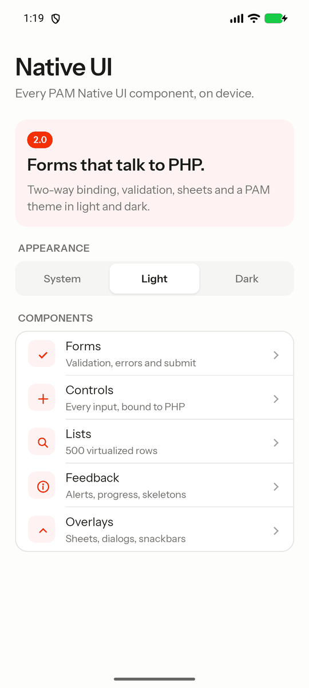
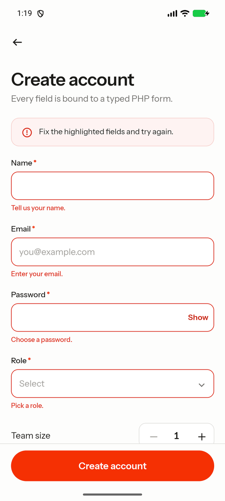
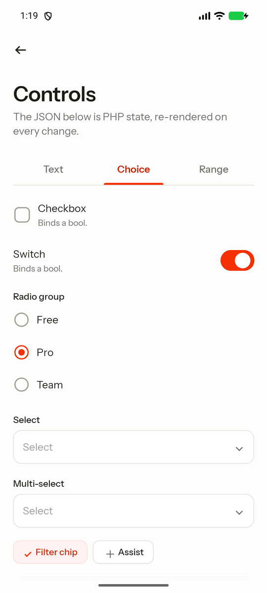
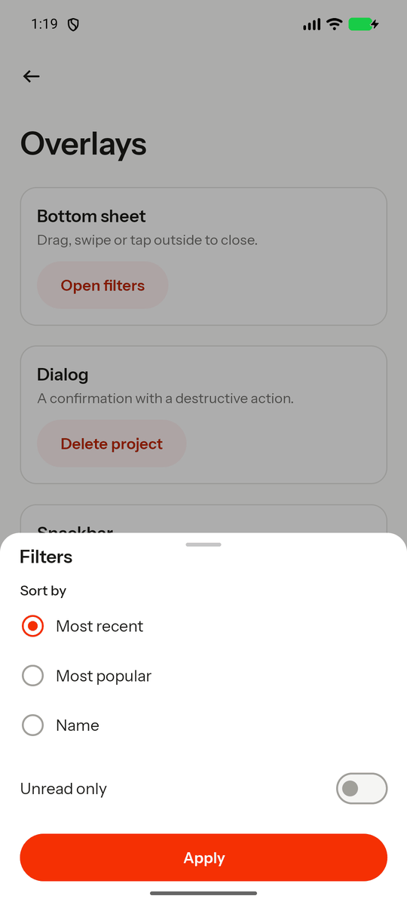
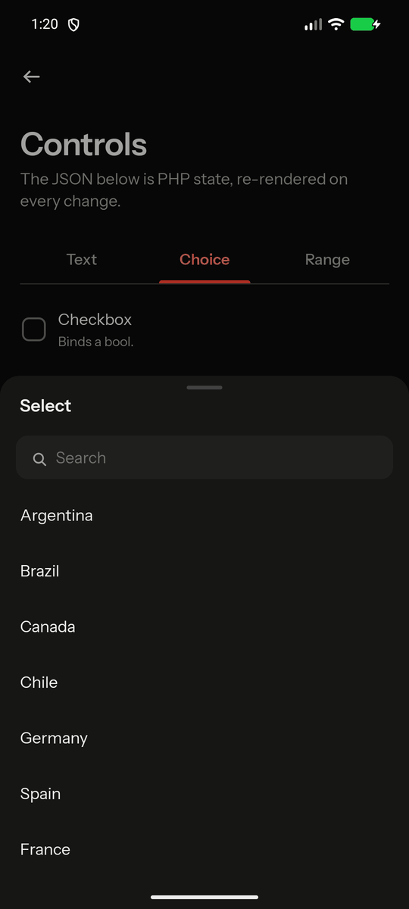
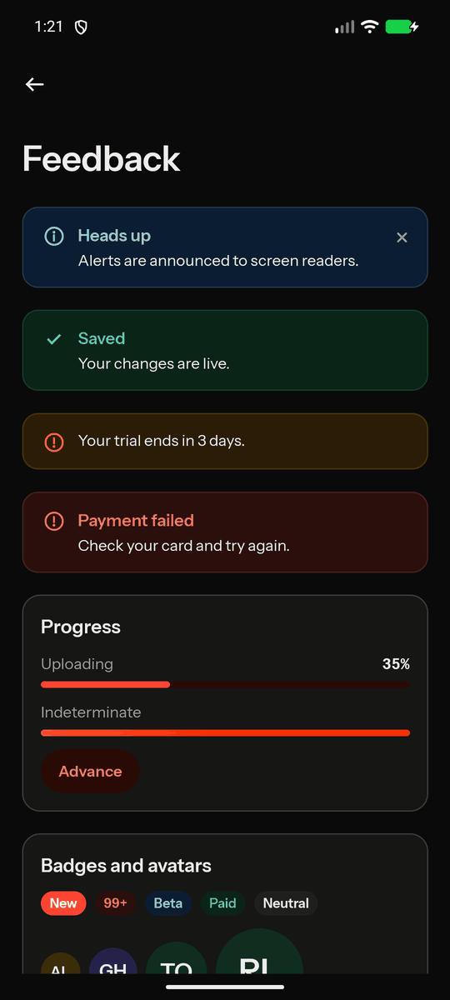
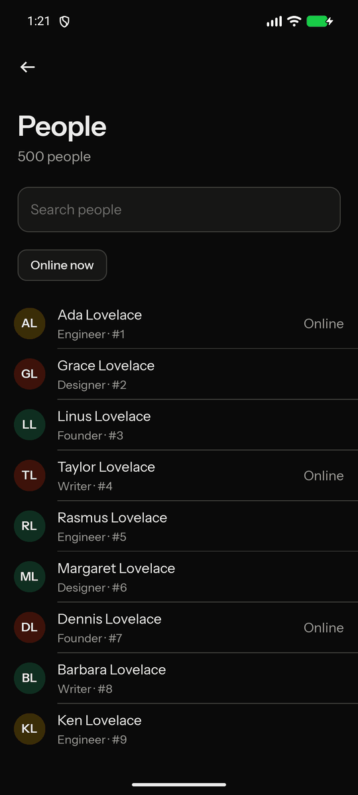
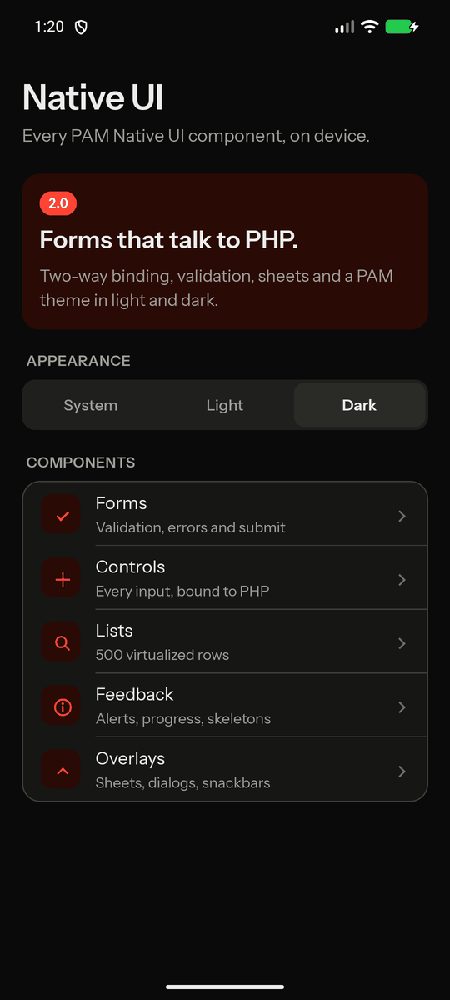

<div align="center">

<picture>
  <source media="(prefers-color-scheme: dark)" srcset=".github/assets/banner-dark.svg">
  
</picture>

**Native forms, sheets and lists for PAM Native, bound two-way to PHP.**<br>
Write `p-model="$email"` and the field and your PHP state stay in sync, on Android and iOS, in light and dark.

[](https://packagist.org/packages/pushinbr/pam-native-ui)
[](https://github.com/push-in/pam-native-ui/releases/latest)

[](https://github.com/push-in/pam-native-ui/actions/workflows/ci.yml)
[](LICENSE)

[Install](#install) · [Quick example](#quick-example) · [Components](#components) · [Forms](#forms) · [Showcase](#showcase) · [Upgrading from 1.x](UPGRADE.md) · [Issues](https://github.com/push-in/pam-native-ui/issues)

</div>

<a id="install"></a>
## <picture></picture> Install

Start a new PAM Native project with the UI library already wired in (PAM 2.2.20 or newer; `pam self-update` first if `pam --version` is older):

```sh
pam init my-app --template native-ui          # starters: --starter auth|tabs|ecommerce|chat|showcase
cd my-app
pam mobile dev
```

Already have a PAM Native project? Add the package and the Instrument Sans font files it uses:

```sh
pam composer require pushinbr/pam-native-ui
mkdir -p assets/fonts && cp vendor/pushinbr/pam-native-ui/resources/fonts/*.ttf assets/fonts/
```

That is all the setup there is. The components are PAM single-file components shipped inside the package; PAM Native 1.51 discovers them from the plugin descriptor at boot and packs them into release builds. There is no Android or iOS code in this package: every component is drawn by the PAM Native renderer with its native views, so both platforms get the same behaviour and the renderer's smoothness.

<a id="quick-example"></a>
## <picture></picture> Quick example

```php
<?php

declare(strict_types=1);

namespace App;

use Pam\Native\Attributes\State;
use Pam\Native\Component;

final class SignIn extends Component
{
    #[State] public string $email = '';
    #[State] public string $password = '';
    #[State] public bool $remember = true;
    #[State] public bool $sending = false;

    public function submit(): void
    {
        $this->sending = true;
        // $this->email, $this->password and $this->remember hold what is on screen.
    }
}
?>

<template>
    <p-screen title="Welcome back" subtitle="Sign in to continue.">
        <p-text-field p-model="$email" label="Email" type="email" required="true" />
        <p-text-field p-model="$password" label="Password" type="password" required="true" @submit="submit" />
        <p-switch p-model="$remember" label="Keep me signed in" />
        <template #footer>
            <p-btn label="Sign in" block="true" size="lg" :loading="$sending" @press="submit" />
        </template>
    </p-screen>
</template>
```

`p-model` binds in both directions: typing updates `$email`, and assigning `$email` in PHP updates the field. Every input follows the same contract: the value arrives as `modelValue`, changes come back as a `model` event (plus a `change` event you can listen to with `@change` or `on:change`).

<a id="components"></a>
## <picture></picture> Components

| Kind | Tags |
| --- | --- |
| Inputs (all `p-model`) | `p-text-field`, `p-textarea`, `p-checkbox`, `p-switch`, `p-radio-group`, `p-select` (single and multiple), `p-date-input`, `p-slider`, `p-stepper`, `p-segmented`, `p-chip`, `p-tabs` |
| Actions | `p-btn` (filled, tonal, outlined, text, danger, neutral), `p-icon-btn` |
| Layout | `p-screen`, `p-card`, `p-section`, `p-list-item`, `p-divider`, `p-form` |
| Feedback | `p-alert`, `p-badge`, `p-avatar`, `p-progress`, `p-skeleton`, `p-empty-state`, `p-icon` |
| Overlays (all `p-model`) | `p-sheet`, `p-dialog`, `p-snackbar` |

Every prop is a typed constructor parameter, so a typo or a wrong type fails with a message that names the component and the prop. The full reference, with every prop and event, is in [docs/components.md](docs/components.md).

Design decisions that apply to every component:

- **Touch targets** are at least 48 dp, labels included in the target.
- **Accessibility**: roles, labels, checked and selected states, values for sliders and steppers, and live regions for errors and alerts are set by the components; read aloud correctly on TalkBack and VoiceOver.
- **Safe areas**: `p-screen`, `p-sheet` and `p-snackbar` keep content clear of the status bar, notch, navigation bar and home indicator; sheet content scrolls above the keyboard.
- **Platform feel**: Material 3 shapes, switch and type sizes on Android; iOS radii, switch, large titles and 17 pt body text on iOS.
- **Motion** runs on the UI thread (pressed scale, switch thumb, tab indicator, slider drag) and respects reduce motion.
- **Lean**: no timers or listeners while hidden; `p-slider` drags without crossing to PHP until release; long lists use PAM Native's `VirtualizedList`.

<a id="forms"></a>
## <picture></picture> Forms and validation

Keep the form in a typed `NativeForm` with rule attributes, bind fields with `p-model="$form->field"` and let `InteractsWithForm` show errors at the right time:

```php
use Pam\Native\Forms\Attributes\{Email, MinLength, Required};
use Pam\Native\Forms\NativeForm;
use Pam\NativeUi\Forms\Rules\Accepted;

final class SignUpForm extends NativeForm
{
    #[Required, Email]
    public string $email = '';

    #[Required, MinLength(8)]
    public string $password = '';

    #[Accepted]
    public bool $terms = false;
}
```

```php
final class SignUp extends Component
{
    use \Pam\NativeUi\Forms\InteractsWithForm;

    public SignUpForm $form;

    public function __construct() { $this->form = new SignUpForm(); }

    public function save(): void
    {
        if (!$this->submitForm()) {
            return; // every error is now visible and announced
        }
        // ... persist, then:
        $this->form->succeed();
    }
}
```

```xml
<p-form :error="formFailed() ? 'Fix the highlighted fields.' : null">
    <p-text-field p-model="$form->email" label="Email" type="email" :error="error('email')" @blur="validateField('email')" />
    <p-text-field p-model="$form->password" label="Password" type="password" :error="error('password')" />
    <p-checkbox p-model="$form->terms" label="I accept the terms" :error="error('terms')" />
    <p-btn label="Create account" :loading="submitting()" @press="save" />
</p-form>
```

Errors appear once a field was touched or a submit failed, and clear as soon as the field changes. Extra rules: `Accepted`, `Between`, `Pattern` and `OneOf` (PAM Native ships `Required`, `Email`, `MinLength`, `MaxLength` and `Matches`). See [docs/forms.md](docs/forms.md).

<a id="showcase"></a>
## <picture></picture> Showcase

[`examples/showcase`](examples/showcase) exercises every component and a validated form. Android emulator, API 36:

<table>
<tr>
<td></td>
<td></td>
<td></td>
<td></td>
</tr>
<tr>
<td></td>
<td></td>
<td></td>
<td></td>
</tr>
</table>

<a id="theme"></a>
## <picture></picture> Theme

The default theme is the PAM brand: Instrument Sans, ink `#0A0A0A` / `#161615` / `#3E3E3A`, paper `#EDEDEC` / `#A1A09A`, and the PAM red `#F53003` as the accent. Light and dark follow the system; switch them from PHP with PAM Native's appearance API, which restyles every component without remounting it:

```php
use Pam\Native\AppearanceMode;
use Pam\NativeUi\NativeUi;

NativeUi::appearance(AppearanceMode::Dark); // System, Light or Dark; persisted natively
```

Set the window colours in `pam-native.json` so the first frame matches (`"appearance": {"light": {"background": "#FDFDFC"}, "dark": {"background": "#0A0A0A"}}`). See [docs/theming.md](docs/theming.md).

<a id="verification"></a>
## <picture></picture> Verification

```sh
composer install && php tests/run.php        # every input through the PAM renderer, in PHP
python3 tools/e2e_android.py --serial emulator-5554 --golden tests/golden/android
python3 tools/e2e_ios.py --layout > e2e-ios.json  # the same scenarios for the iOS UI driver
```

- `tests/run.php` renders each component with the PAM Native template renderer, fires the native event closures and checks the PHP state.
- `tools/e2e_android.py` drives the showcase on a device: every input and every declared event must reach PHP (the screens print their PHP state as JSON), sheets and dialogs close by back, scrim and swipe, the keyboard opens and closes, light and dark.
- At each state it checks the real layout (`tools/geometry.py`): 48dp touch targets, nothing under a system bar, no truncated or overlapping text, siblings snapped to the same pixels, even spacing, shared baselines and centred icons. It then compares a golden screenshot (`tools/golden.py`, tolerance documented in the file).
- `tools/zero_errors.py` fails on any warning or error the app logged, and checks that a multi-file hot reload logs none.
- CI runs the Android suite on every pull request (`.github/workflows/e2e.yml`).

<a id="docs"></a>
## <picture></picture> Docs

- [Component reference](docs/components.md)
- [Forms and validation](docs/forms.md)
- [Theme, light and dark](docs/theming.md)
- [Upgrading from 1.x](UPGRADE.md)
- [Performance](docs/performance.md)
- [1.0.8 audit: why 2.0](docs/audit-1.0.md)
- [Changelog](CHANGELOG.md)
- [PAM Native core](https://github.com/push-in/pam-native): runtime, renderer, navigation and platform modules
- [PAM Native documentation](https://push-in.github.io/pam-docs/native/overview/): start here if you are new to native PHP applications

<a id="pam-ecosystem"></a>
## <picture></picture> Part of the PAM ecosystem

<p align="center"><picture>
  <source media="(prefers-color-scheme: dark)" srcset=".github/assets/pam-wordmark-dark.svg">
  
</picture></p>

PAM runs PHP natively on servers, desktops and phones. This repository is one piece of it.

| [**PAM**](https://github.com/push-in/pam) | [**PAM Desktop**](https://github.com/push-in/pam-desktop) | [**PAM Native**](https://github.com/push-in/pam-native) | [**Ecosystem**](https://github.com/push-in/pam#ecosystem) |
| --- | --- | --- | --- |
| the runtime and CLI | native desktop apps in PHP | native Android and iOS apps in PHP | every official package and plugin |

<sub>Docs: [push-in.github.io/pam-docs](https://push-in.github.io/pam-docs/introduction/) · [Issues](https://github.com/push-in/pam-native-ui/issues)</sub>

<p align="center"><sub><a href="LICENSE">Apache-2.0</a>, see also <a href="LICENSING.md">LICENSING.md</a> · Made in Brazil by Pushin</sub></p>
