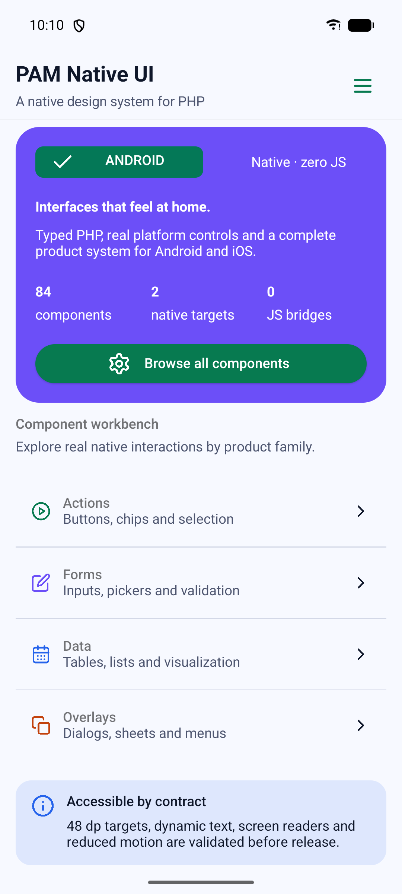
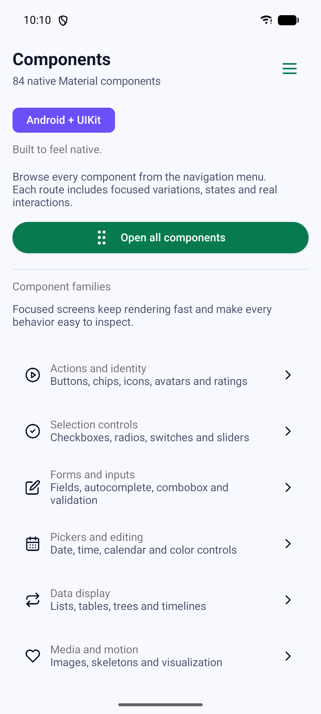
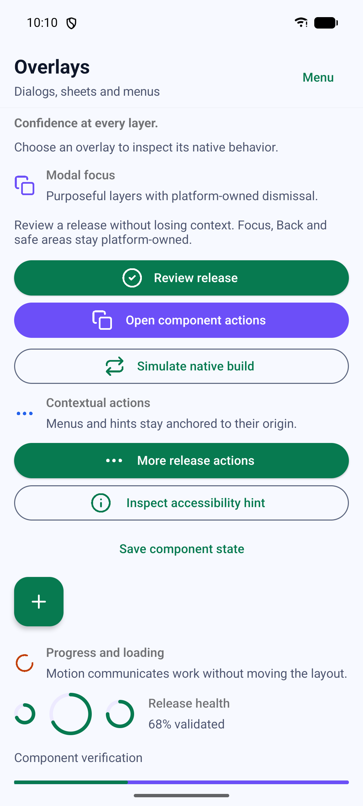

<div align="center">

<picture>
  <source media="(prefers-color-scheme: dark)" srcset=".github/assets/banner-dark.svg">
  
</picture>

**A complete retained-native component system designed for sustained frame rates.**<br>
Compose accessible Android Views and UIKit controls with tokens, themes, responsive layouts, gestures, and UI-thread animation.

[](https://packagist.org/packages/pushinbr/pam-native-ui)
[](https://github.com/push-in/pam-native-ui/releases/latest)

[](https://github.com/push-in/pam-native-ui/actions/workflows/verify.yml)
[](LICENSE)

[Install](#install) · [Quick example](#quick-example) · [Showcase](#android-showcase) · [Themes](#themes) · [Docs](#docs) · [Issues](https://github.com/push-in/pam-native-ui/issues)

</div>

<a id="install"></a>
## <picture></picture> Install

Start a new PAM Native project with the UI library already wired in:

```sh
pam init my-app --template native-ui
cd my-app
pam doctor --fix
pam dev
```

`pam init --template native-ui` already requires `pushinbr/pam-native` and `pushinbr/pam-native-ui` (`^1.0`). Already have a PAM Native project? Add only this capability:

```sh
pam composer require pushinbr/pam-native-ui
pam doctor --fix
```

Composer owns the manifest and the lockfile; the plugin's `pam-native.plugin.json` is discovered and the Android and iOS native view registries are refreshed. New to PAM Native? Follow the [five-minute PAM Native setup](https://push-in.github.io/pam-docs/native/overview/) once.

All builds follow the mandatory [build hygiene contract](docs/build-hygiene.md): final deliverables remain in `dist`, while regenerable native build outputs are removed on exit.

<a id="quick-example"></a>
## <picture></picture> Quick example

PAM Native UI is a retained native Material Design 3 component library for PAM Native. It exposes 114 mobile `p-*` component parts across 92 manually authored modules and renders through Android views and UIKit without a WebView, JavaScript runtime, CSS engine, or Vuetify metadata importer.

This library does not wrap a web design system and call it native. Its components, themes, motion, interaction, accessibility semantics, responsive behavior, and platform contracts are designed for the PAM renderer itself. The public API stays expressive and familiar; the work underneath stays close to the operating system.

A screen in the template language:

```xml
<AppScreen>
        <p-card class="pa-6">
            <Text size="xl">Production dashboard</Text>
            <Text>Retained native Material UI</Text>
            <Text>One component contract, two native renderers.</Text>
            <p-card-actions>
                <p-btn @press="continue">Continue</p-btn>
            </p-card-actions>
        </p-card>
</AppScreen>
```

Templates are compiled once. Android and iOS receive resolved integers,
floats, booleans and bounded payloads rather than markup or style strings.

Product feedback uses the typed `StatusBanner` instead of one-off alert
layouts. Its integer-backed tones cover information, success, warning, error
and progress, with screen-reader announcements and optional 48 dp actions.
Dashboard values use `MetricCard`, whose adaptive layout and semantic trend
labels remain understandable without color.

<a id="platform-support"></a>
## <picture></picture> Platform support

| Platform | Support | Notes |
| --- | --- | --- |
| Android | API 26+ | Android Views, `RippleDrawable`; from `pam-native.plugin.json` |
| iOS | 15.0+ | UIKit; from `pam-native.plugin.json` |
| PAM Native | 1.0.27 to < 2.0.0 | From `pam-native.plugin.json`; PHP 8.5+ |

<a id="requirements"></a>
## <picture></picture> Permissions and requirements

The plugin declares no Android permissions and no iOS usage descriptions. It requires the PAM Native capabilities `renderer.incremental.v1`, `runtime.modules.v1` and `wire.binary.v1` (from `pam-native.plugin.json`).

<a id="why-pam-native-ui"></a>
## <picture></picture> Why PAM Native UI

Compose accessible Android Views and UIKit controls with tokens, themes, responsive layouts, gestures, and UI-thread animation. The public API is strictly typed for PHP 8.5; expensive or frame-sensitive work stays in Rust or the platform SDK instead of crossing the application boundary every frame.

| | |
| --- | --- |
| **Best for** | A focused capability you can add to any PAM Native application |
| **Native path** | Android Views · UIKit · Rust layout/reconciliation |
| **Application model** | Composer package + generated native integration |
| **Design rule** | Independent module; no feed, vertical, or application template bundled |

**What you can build**

- Production mobile design systems
- Responsive phone, tablet, foldable, and TV interfaces
- Accessible components with native focus and input behavior

<a id="android-showcase"></a>
## <picture></picture> Android showcase

The bundled catalog exercises all 114 public component parts through the real
Android renderer. Each public route has a full-device Android candidate capture;
physical-device interaction approval remains tracked separately and cannot be
granted by screenshot-only validation.

<p align="center">
  
  
  
</p>

See the **[Android visual showcase](docs/android-showcase.md)** for every
component screenshot, capture metadata and real interaction GIFs.

<a id="what-we-are-building"></a>
## <picture></picture> What we are building

| Promise | Implementation |
| --- | --- |
| One component language | Typed PHP and declarative `p-*` tags share the same retained tree |
| Real native output | Android Views and UIKit, not HTML or a canvas |
| Material Design 3 | Semantic color, typography, shape, elevation and motion tokens |
| Native performance | Gesture animation and transient interaction stay on the UI thread |
| Accessibility by contract | Semantics are part of component parity and release verification |
| Honest parity | A generated manifest and executable tests gate the published surface |
| Extensible foundations | Themes, directives and native capabilities compose without forking the renderer |

<a id="principles"></a>
## <picture></picture> Principles

- Public templates use only the `p-*` namespace.
- Components are implemented manually for Android and iOS.
- Theme, layout, motion and interaction resolve to compact numeric native
  properties.
- Coded variants use sequential integer enums rather than string protocol
  discriminators.
- Gesture animation and transient state remain on the native UI thread.
- PHP receives requested semantic results, not animation frames.

Product-safe factories for Bottom Sheet, WebView, native media, context menus
and keyframe entrance motion are available through `NativeCapabilities`; see
[`docs/native-capabilities.md`](docs/native-capabilities.md).

<a id="native-directives"></a>
## <picture></picture> Native directives

```xml
<p-card
    p-ripple
    p-click-outside="close"
    p-intersect="visibilityChanged"
    p-resize="resized"
    p-touch-start="touchStarted"
    p-touch-move="touchMoved"
    p-touch-end="touchEnded"
>
    <Text>Interactive native surface</Text>
</p-card>
```

- `p-ripple` uses `RippleDrawable` on Android and a UIKit state layer.
- `p-click-outside` observes the native root without consuming child input.
- `p-intersect`, `p-mutate` and `p-resize` emit only changed geometry.
- `p-scroll` uses native scroll delegates and display-frame coalescing.
- `p-touch-*` reports logical local/page coordinates.

All observers and recognizers detach on update, unmount, hot reload and runtime
shutdown. Ripple and motion do not cross the PHP boundary.

<a id="themes"></a>
## <picture></picture> Themes

Language 2 templates use PHP-free Vue-style bindings. Interpolate text with
`{{ $value }}`, bind properties with `:prop="$value"`, dispatch actions with
`@press="action"`, and bind form state in both directions with
`p-model="$field"`:

```xml
<p-text-field p-model="$query" label="Search" />
<p-img :source="$channel->logo" :accessibilityLabel="$channel->name" />
<p-btn @press="play">Play {{ $channel->name }}</p-btn>
```

```php
use Pam\MobileUi\Enum\ColorToken;
use Pam\MobileUi\PamUI;
use Pam\MobileUi\Theme\Color;
use Pam\MobileUi\Theme\Themes;

PamUI::theme(
    Themes::pamLight()->withColors([
        ColorToken::Primary->value => Color::rgb(0, 95, 184),
    ]),
    Themes::pamDark()->withColors([
        ColorToken::Primary->value => Color::rgb(167, 201, 255),
    ]),
);
```

System, light, dark and custom themes resolve per provider subtree. Components
consume semantic MD3 color, typography, shape, elevation and motion tokens.
`pamLight()` and `pamDark()` ship the contrast-gated PAM identity; `light()` and
`dark()` remain neutral foundations for fully custom brands.

<a id="verification"></a>
## <picture></picture> Verification

```bash
pam composer generate:material
pam composer test
pam composer test:recipes
pam composer analyse
pam composer release:check
```

`resources/material-parity.json` is the release gate for the new generation.
It is generated from the manual specification and requires:

- 92 sequential modules;
- 114 mobile `p-*` components with sequential component IDs;
- Android and iOS targets;
- `metadataImport=false`;
- exact equality with `MaterialComponentMap`.

Android contracts run as unit tests, emulator instrumentation and physical ADB
tests. UIKit contracts build and test through Xcode on a macOS runner before a
release can be published.

<a id="docs"></a>
## <picture></picture> Docs

- [Authoring](docs/authoring.md): components, themes, accessibility and performance
- [Component catalog](docs/catalog.md)
- [Android visual showcase](docs/android-showcase.md)
- [Parity contract](docs/parity.md)
- [Product foundations](docs/product-foundations.md)
- [Native capabilities](docs/native-capabilities.md)
- [Architecture](docs/architecture.md)
- [Performance evidence](docs/performance.md)
- [Build hygiene](docs/build-hygiene.md)
- [PAM Native core](https://github.com/push-in/pam-native): required native runtime, renderer, navigation and platform modules
- [PAM Native Nitro](https://github.com/push-in/pam-native-nitro): high-performance offline-first data for native applications
- [PAM Native documentation](https://push-in.github.io/pam-docs/native/overview/): start here if you are new to native PHP applications
- [Changelog](CHANGELOG.md)

<a id="pam-ecosystem"></a>
## <picture></picture> Part of the PAM ecosystem

<p align="center"><picture>
  <source media="(prefers-color-scheme: dark)" srcset=".github/assets/pam-wordmark-dark.svg">
  
</picture></p>

PAM runs PHP natively on servers, desktops and phones. This repository is one piece of it.

| [**PAM**](https://github.com/push-in/pam) | [**PAM Desktop**](https://github.com/push-in/pam-desktop) | [**PAM Native**](https://github.com/push-in/pam-native) | [**Ecosystem**](https://github.com/push-in/pam#ecosystem) |
| --- | --- | --- | --- |
| the runtime and CLI | native desktop apps in PHP | native Android and iOS apps in PHP | every official package and plugin |

<sub>Docs: [push-in.github.io/pam-docs](https://push-in.github.io/pam-docs/introduction/) · [Issues](https://github.com/push-in/pam-native-ui/issues)</sub>

<p align="center"><sub><a href="LICENSE">Apache-2.0</a>, see also <a href="LICENSING.md">LICENSING.md</a> · Made in Brazil by Pushin</sub></p>
