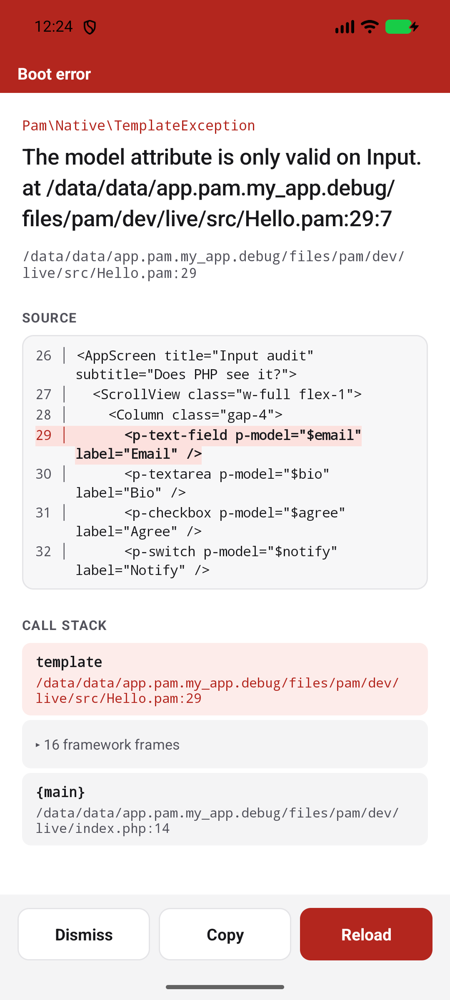

# PAM Native UI 1.0.8 audit

Reproduced on 2026-11-17 the way a community developer meets the package:

```bash
pam init my-app --template native-ui   # PAM 2.2.18
cd my-app && pam mobile dev            # pam-native 1.50.5, pam-native-ui 1.0.8
```

Device: Android 16 emulator (`pam-ci-36`, x86_64, `-gpu host`). Every input
was driven with `adb shell input` and the PHP state was read back from a
`<Text>` that prints the component's `#[State]` properties.

Control: on the same screen the core `<Input p-model="$email">` and
`<Switch p-model="$notify">` from pam-native round-trip correctly
(`dev@pam.dev` typed, `PHP: [dev@pam.dev] [on]`). The bridge, the renderer and
the state system work; the failures below are in this package and in how the
core binds `p-model` to component tags.

## Input values never reach PHP



| Case | Template | Result |
| --- | --- | --- |
| Documented binding (README "Themes" section) | `<p-text-field p-model="$query" />` | Boot error: `The model attribute is only valid on Input.` |
| Every `p-*` input with `p-model` | text field, textarea, checkbox, switch, slider, select, date input | Same boot error for each one |
| `pam init --starter auth`, `ecommerce`, `chat` | starters use `p-model` on `p-text-field` | App does not boot |
| Documented events (`authoring.md`) | `:value="$email" @change="setEmail"` | No error, handler never runs |
| Native events | `on:change`, `on:toggle` | No error, handler never runs |
| Text field typing | type `dev@pam.dev` | Field keeps only `d`; the rest of the input is lost |
| Checkbox / switch tap | `@change` or `on:toggle` | Control animates, PHP stays `false` |
| Slider drag | `@change` or `on:change` | Thumb moves, PHP never notified |
| Select tap | `p-select` with `:items` | Menu never opens |
| Date input | pick a day in the system dialog, OK | Field keeps the old date, PHP never notified |

### Root causes

1. **Core: `p-model` is Input-only.** `TemplateRenderer::modelBindings()`
   rewrites `p-model` to a `model` attribute and then throws unless the
   rendered root element is a core `Input`. A component tag (`p-text-field`,
   a user's `.pam` component) can never take `p-model`.
2. **`@event` listeners are dropped.** The core passes component-tag listeners
   to factories in `__pamComponentEvents`. `UiComponent::fromTemplate()` never
   reads them (only `AppScreen`, `StatusBanner` and `ContentState` do), so
   `@change`, `@press` and every other `@` listener on a `p-*` tag disappears.
3. **`on:` events land on the wrong view.** For a factory tag the core attaches
   `on:change` to the root element the factory returns. Every input is a
   `pam.mobile_ui.host` custom view wrapping label, helper and the real
   `EditText`/track/thumb, so the handler is attached to a container that never
   emits `change`. The inner `Input` is rendered without any handler.
4. **Controlled value echo.** The inner `Input` is re-rendered with the old
   `value` after every keystroke because PHP was never told about the new one,
   so the native field is reset to the stale value while the user types.
5. **Selection, date and slider state live in a 9,400-line Kotlin host and a
   4,000-line Swift host.** The host animates the control locally and emits
   `CHANGE`/`TOGGLE` only on paths that the PHP side does not listen to. Two
   platform hosts that duplicate core primitives (switch, input, sheets,
   pickers, ripple) are the reason behaviour drifts between platforms.

## Other findings

- **Theme.** The default palette is Material blue (`#1A65C0`), not the PAM
  brand. Light only unless the app calls `PamUI::mode()`; dark mode is not
  verified on the starters.
- **Keyboard.** With the keyboard open the lower fields (date) stay behind it;
  `AppScreen` does not keep the focused field visible.
- **Starters.** `tabs` renders three buttons that do nothing (no navigation).
  `auth`, `ecommerce` and `chat` do not boot (see above).
- **Documentation.** README and `authoring.md` show three different binding
  styles (`p-model`, `value="{{ }}" @change`, `on:change`); none of them works.
- **Example.** `examples/kitchen-sink` requires `pushinbr/pam-native 1.0.27`
  from a sibling path (`../../../pam-native/packages/native`) that does not
  exist in a clone, so it cannot be installed.
- **Size.** The Composer dist ships the Android and iOS hosts, benchmarks,
  tools and tests; the repository carries 640+ screenshot/GIF assets
  (127 MB checkout).
- **Generated surface.** 90 `p-*` tags are generated from a spec into an
  11,000-line `ComponentRenderer` with string-typed props; there are no typed
  constructor props, so a typo in a prop name is silently ignored.
- **Template noise.** The `native-ui` template installs `phpunit` as a dev
  dependency; `pam mobile dev` then prints 34 "extension not available on the
  device" warnings for PHPUnit files on every start.

## Related core issues (reported by the PushinPay port)

- `Icon` resolves `assets/fonts/<Font>.ttf` from `getcwd()`; during Android hot
  reload the working directory is not the project, so a bundled icon font
  fails with "Unknown icon font".
- `->statusBar('light')` on a `Route::screen()` renders an empty screen.
- An image or font added while `pam dev` runs only appears after restarting
  `pam dev`.

## Direction for 2.0

Rebuild the library as PAM single-file components (`.pam.php`) rendered with
core primitives (`Input`, `Switch`, `Pressable`, `BottomSheet`, `Modal`,
`VirtualizedList`, scoped CSS) so Android and iOS share one implementation and
the core renderer's smoothness. Fix `p-model` for component tags in the core,
so `p-model="$field"` works on every input, and remove the native hosts.
